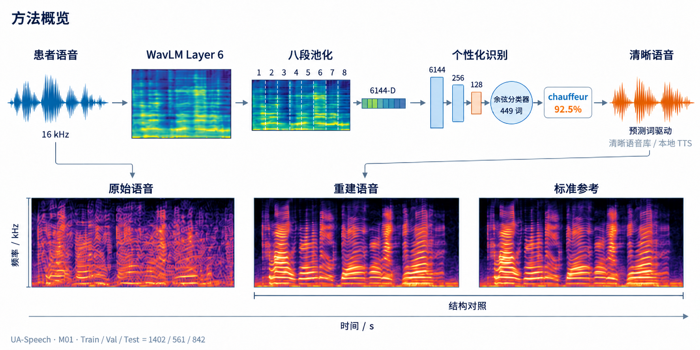
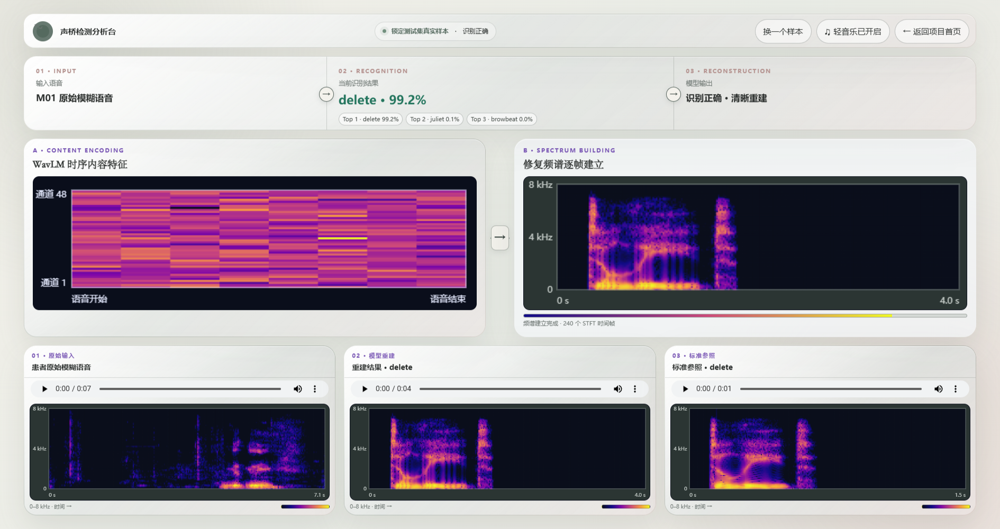
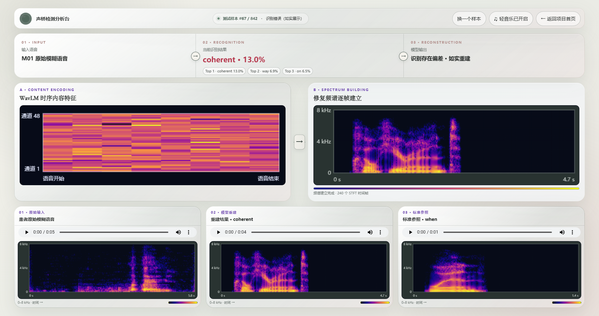

# 声桥 · Voice Bridge

> 面向构音障碍/含混语音的个性化识别与清晰语音重建研究原型。

“声桥”希望在说话者与倾听者之间搭起一座更容易理解的桥：系统从含混语音中提取稳定的内容特征，完成个性化词级识别，再以清晰参考语音呈现识别结果，并用频谱和中间特征把处理过程直观展示出来。


## HTML 在线展示

本仓库自带完整双层 HTML 界面，并通过 GitHub Pages 自动部署。公开页面使用内置科研示意图展示交互流程，不加载患者音频、测试数据或模型权重。

- 项目首页：`https://github.com/zhouzhou-cnqd/shengqiao`
- 在线界面：`https://zhouzhou-cnqd.github.io/shengqiao/`

> 仓库首次推送后，请在 **Settings → Pages** 中确认 Source 为 **GitHub Actions**。

## 为什么做这个项目

构音障碍语音常伴随发音边界不清、时长变化和频谱结构偏移，通用语音识别模型容易失效。声桥当前不追求“一套模型识别所有人”，而是聚焦更可落地的目标：针对单一使用者建立个性化模型，在封闭词表场景中提高识别稳定性，并把“输入—理解—重建”的过程做成可解释、可体验的浏览器演示。

项目主要面向：

- 个性化辅助沟通与无障碍交互的研究验证；
- 构音障碍语音识别、特征分析和重建展示；
- 不上传患者原始语音的本地隐私优先原型。

## 实现路线



1. **健康语音基底**：使用普通语音上的自监督预训练模型作为通用声学表征起点，减少对患者标注数据量的依赖。
2. **个性化监督学习**：对目标说话者的语音按“说话者 × 词”进行分层划分，并只在训练集上拟合轻量分类头。
3. **内容特征编码**：提取 WavLM 第 6 层时序特征，将每条语音划分为 8 个时间段并聚合成 6144 维输入。
4. **词级识别**：两层投影网络将特征映射至 128 维归一化嵌入，再通过余弦分类器完成 449 类封闭词表识别。
5. **清晰语音重建**：根据预测词检索清晰语音参考，形成可播放的重建结果，并生成 STFT 频谱用于对照展示。
6. **端侧演示**：浏览器随机抽取本地测试样本，展示识别结果、中间特征、频谱逐步建立过程和三路音频对照。

## 数据与预训练来源

本项目没有自行采集患者语音，实验数据和预训练基底如下：

| 环节 | 实际来源 | 本项目如何使用 | 是否随仓库公开 |
| --- | --- | --- | --- |
| 构音障碍语音 | [UA-Speech 官方语料](https://speechtechnology.web.illinois.edu/uaspeech/)，实验时读取了社区整理的 [`shun31y/uaspeech_tts_high`](https://huggingface.co/datasets/shun31y/uaspeech_tts_high) 本地 Parquet 快照 | 仅选择快照中的 M01，说话者内按词分层为 50%/20%/30% | 否 |
| 通用声学基底 | [`microsoft/wavlm-base-plus`](https://huggingface.co/microsoft/wavlm-base-plus) | 16 kHz 输入，提取第 6 层表征；其官方模型卡说明预训练语料为 Libri-Light 60k h、GigaSpeech 10k h、VoxPopuli 24k h | 不重新分发权重 |
| 清晰语音参考 | Windows SAPI 本地 TTS | 根据识别词生成/检索清晰参考语音，仅用于展示链路 | 否 |
| GitHub 单音频示例 | `demo_single_audio.py` 确定性生成的合成语音状信号 | 演示 16 kHz 标准化、播放和 STFT 频谱，不冒充患者语音或模型推理 | 只公开生成代码 |

UA-Speech 原始论文为 [Kim et al., *Dysarthric speech database for universal access research*, Interspeech 2008](https://www.isca-archive.org/interspeech_2008/kim08c_interspeech.html)。官方页面明确规定：语料仅供政府或学术研究机构研究使用、禁止商业用途、须防止数据被盗且不得再分发。因此本仓库不会提交任何 UA-Speech 音频、派生音频、逐样本清单、特征或权重；第三方镜像仅用于说明本实验当时读取的技术来源，不替代官方授权。若要复现实验，应首先向 UA-Speech 官方申请合法访问。

当前 M01 可用子集共 2,805 条、449 个词类。固定随机种子 42，按每个词内部进行 50%/20%/30% 划分，得到训练 1,402、验证 561、测试 842 条。这里的“健康语音基底”准确地指微软已经完成的 WavLM 自监督预训练，本项目没有重新收集或训练一套健康人语料。

## 当前结果

当前版本针对单一说话者 M01，使用 50% / 20% / 30% 的训练、验证和测试划分：

| 数据划分 | 样本数 | Top-1 | Top-3 |
| --- | ---: | ---: | ---: |
| 验证集 | 561 | 75.94% | 79.50% |
| 测试集 | 842 | 72.92% | 76.60% |

- 封闭词表：449 个词；
- 最佳轮次：Epoch 24；
- 演示同时保留识别成功状态与错误状态，用于展示系统能力和当前边界。

### 成功案例



> 锁定测试集真实成功样本：目标词与模型预测均为 `delete`，置信度 99.18%。经项目所有者明确授权，截图公开输入频谱、WavLM 特征可视化、重建频谱和标准参考；仓库仍不提供原始 WAV、可下载特征张量、测试池或模型权重。

### 失败案例



> 失败结果同样保留，用于如实呈现模型在个别词语上的混淆和当前能力边界。

## 如何理解“重建”

当前版本的重建是**预测文本驱动的清晰语音检索/合成链路**：模型先判断输入内容，再调用对应的清晰语音参考。它不是端到端波形生成模型，也不代表已经恢复出患者本人的健康音色。界面中的“标准参考”用于科研对照；公开仓库不包含任何患者音频、测试样本或语音库。

这一定义刻意保持透明，避免把“识别正确”和“波形级语音恢复”混为一谈。后续可将该接口替换为声码器、扩散式语音重建或个性化 TTS，而不改变前端分析流程。

## 仓库结构

```text
.
├─ dsr_demo/
│  ├─ index.html                 # 双层浏览器演示界面
│  └─ assets/                    # 公共视觉素材
├─ docs/images/                  # README 截图
├─ demo_single_audio.py          # 无数据/无权重的单音频演示
├─ train_personalized_m01.py     # 个性化分类头训练示例
├─ build_random_demo_pool.py     # 本地演示索引构建脚本
├─ generate_random_voice_bank.ps1# Windows 本地清晰语音生成示例
├─ check_public_release.py       # 发布前隐私/大文件检查
├─ DATA_POLICY.md                # 数据与权重公开边界
└─ requirements.txt
```

## 本地预览

```bash
python -m http.server 8765 --directory dsr_demo
```

打开 `http://127.0.0.1:8765/` 即可查看首页。完整随机体验需要在本地按约定目录放入授权测试资源；资源目录已被 `.gitignore` 排除，不会随代码上传。

### 单音频演示脚本

无需数据集或模型权重即可生成一个自包含 HTML 示例：

```bash
python demo_single_audio.py
```

默认音频由脚本确定性合成，不来自任何患者。也可以分析自己有权使用的 16-bit PCM WAV：

```bash
python demo_single_audio.py --input /path/to/authorized.wav --output /tmp/shengqiao-demo.html
```

脚本只做标准化、播放和 STFT 频谱展示，不会伪装成私有模型的识别或重建结果。

## 一键发布到新仓库

先在 GitHub 新建一个名为“声桥”的空仓库（不要勾选自动生成 README），然后在 PowerShell 中运行：

```powershell
.\publish.ps1
```

脚本会依次执行隐私检查、提交整理、绑定新仓库和推送。若仓库地址不同，可运行：

```powershell
.\publish.ps1 -RepoUrl "https://github.com/你的账号/你的仓库.git"
```

## 训练示例

```bash
pip install -r requirements.txt
python train_personalized_m01.py
```

训练脚本默认读取本地预计算特征。数据集、特征路径及实验参数请按自己的授权环境调整。提交前建议运行：

```bash
python check_public_release.py
```

## 隐私与公开边界

本仓库仅公开界面、方法说明和可复用代码，不公开：

- 患者或健康对照的原始/处理后音频；
- 训练、验证和测试划分清单；
- 可下载的 WavLM 特征张量、频谱缓存、演示样本池及标签级明细（README 仅展示一张经授权的静态科研截图）；
- 模型权重、检查点、原型向量和私有实验配置。

详细规则见 [DATA_POLICY.md](DATA_POLICY.md)。如需复现实验，请自行准备具备合法授权的数据，并遵守相关伦理、隐私与数据使用协议。

## 项目状态

研究原型，当前聚焦单人个性化、封闭词表识别与可解释演示。暂未附加开源许可证；未经许可，不应将仓库内容用于商业部署或临床决策。

